# olist-lakehouse-databricks

An end-to-end lakehouse on Databricks that takes the Olist e-commerce dataset from raw CSV files to analytics-ready tables, built with PySpark and Delta Lake using the Medallion architecture.

> 🚧 **Work in progress** — Bronze layer done; Silver and Gold coming next.

## Architecture

```mermaid
flowchart LR
    CSV["Raw CSVs<br/>(8 Olist files)"]
    Volume["Unity Catalog Volume<br/>olist.bronze.raw_data"]
    Bronze["Bronze Layer<br/>Raw Delta tables + metadata"]
    Silver["Silver Layer<br/>Cleaned & deduplicated"]
    Gold["Gold Layer<br/>Star schema & marts"]
    Dashboard["BI Dashboard<br/>Databricks SQL"]

    CSV --> Volume
    Volume --> Bronze
    Bronze --> Silver
    Silver --> Gold
    Gold --> Dashboard

    classDef sourceStyle stroke:#fb923c,fill:#fff7ed,color:#111
    classDef bronzeStyle stroke:#f87171,fill:#fef2f2,color:#111
    classDef silverStyle stroke:#38bdf8,fill:#f0f9ff,color:#111
    classDef goldStyle stroke:#facc15,fill:#fefce8,color:#111
    classDef dashStyle stroke:#4ade80,fill:#f0fdf4,color:#111

    class CSV sourceStyle
    class Volume bronzeStyle
    class Bronze bronzeStyle
    class Silver silverStyle
    class Gold goldStyle
    class Dashboard dashStyle
```

## Dataset

The [Brazilian E-Commerce Public Dataset by Olist](https://www.kaggle.com/datasets/olistbr/brazilian-ecommerce) contains 100k orders placed between 2016 and 2018, split across 8 relational CSV files covering customers, orders, order items, payments, reviews, products, sellers, and category translations.

## Tech Stack

Databricks Free Edition · Unity Catalog · Delta Lake · PySpark · Spark SQL · GitHub

## Project Structure
- notebooks/00_setup → catalog, schemas and volumes
- notebooks/01_explore_raw_files → list files and count orders files
- notebooks/02_bronze_ingestion → Batch ingestion of all 8 CSVs into olist.bronze Delta tables with audit metadata (_ingested_at, _source_file) and row-count assertions
- docs/decisions.md → Architectural and engineering design decisions log
## Data Quality

Automated row-count reconciliation verifying zero record loss between raw CSV files and ingested Bronze Delta tables:

olist.bronze.customers: csv=99441 table=99441 OK

olist.bronze.order_items: csv=112650 table=112650 OK

olist.bronze.order_payments: csv=103886 table=103886 OK

olist.bronze.order_reviews: csv=104162 table=104162 OK

olist.bronze.orders: csv=99441 table=99441 OK

olist.bronze.products: csv=32951 table=32951 OK

olist.bronze.sellers: csv=3095 table=3095 OK

olist.bronze.category_translation: csv=71 table=71 OK

## Design Decisions

See [docs/decisions.md](docs/decisions.md).

## Roadmap

- [x] **Setup & Bronze Layer (`P1-01` – `P1-03`):** Unity Catalog setup, raw file exploration, and Bronze ingestion with row-count checks
- [ ] **Documentation (`P1-04`):** README and design decisions log update
- [ ] **Silver Layer (`P1-05` – `P1-07`):** Data cleaning, type casting, deduplication, and standardized tables
- [ ] **Gold Layer (`P1-08` – `P1-11`):** Dimensional modeling (facts and dimensions) and analytical marts
- [ ] **Quality, Orchestration & BI (`P1-12` – `P1-15`):** Automated data quality suite, Databricks Job workflow, and SQL dashboard
- [ ] **Publish (`P1-16` – `P1-18`):** Final polish, end-to-end verification, and portfolio release